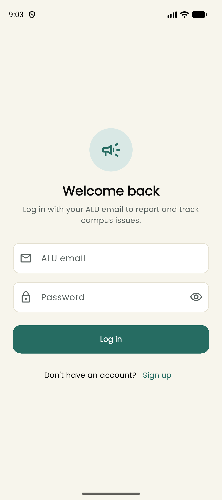
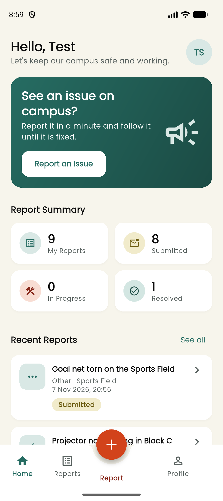
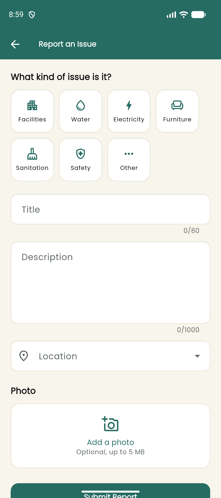
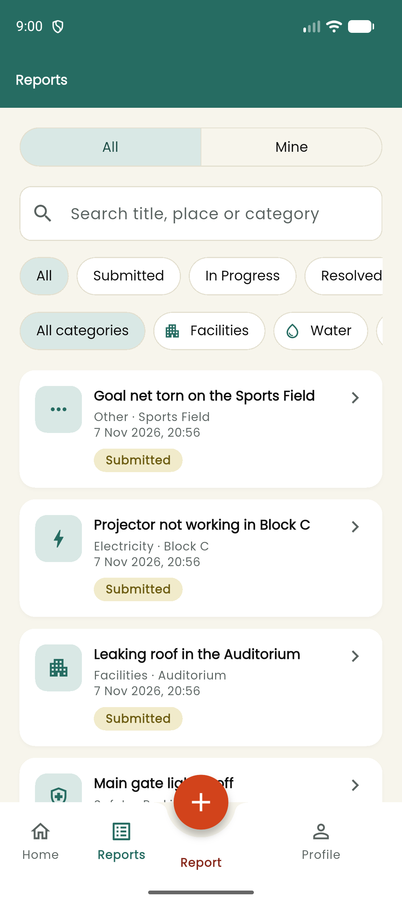
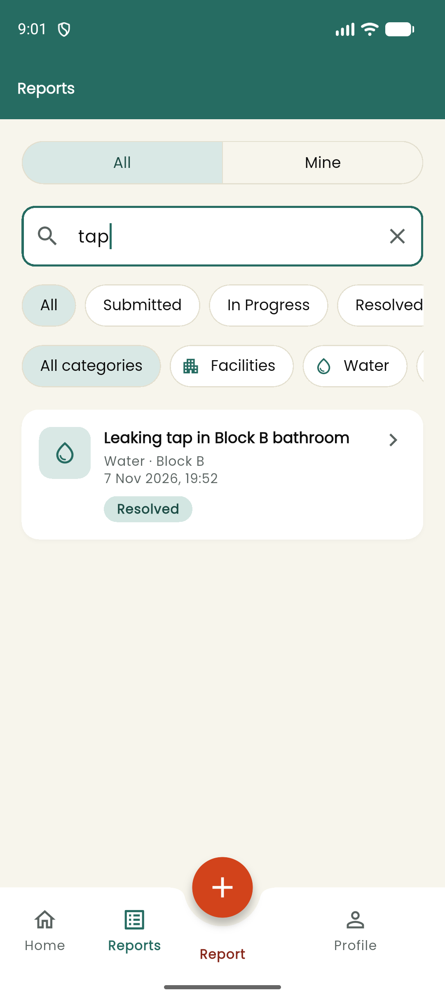
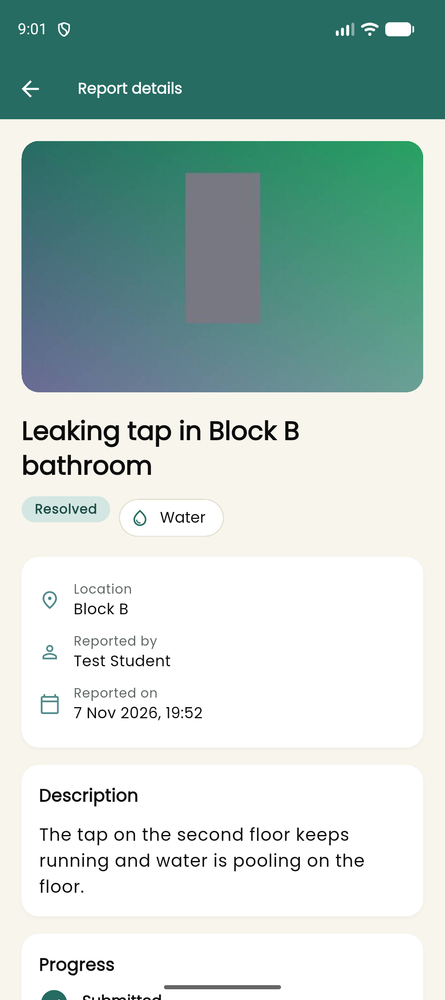
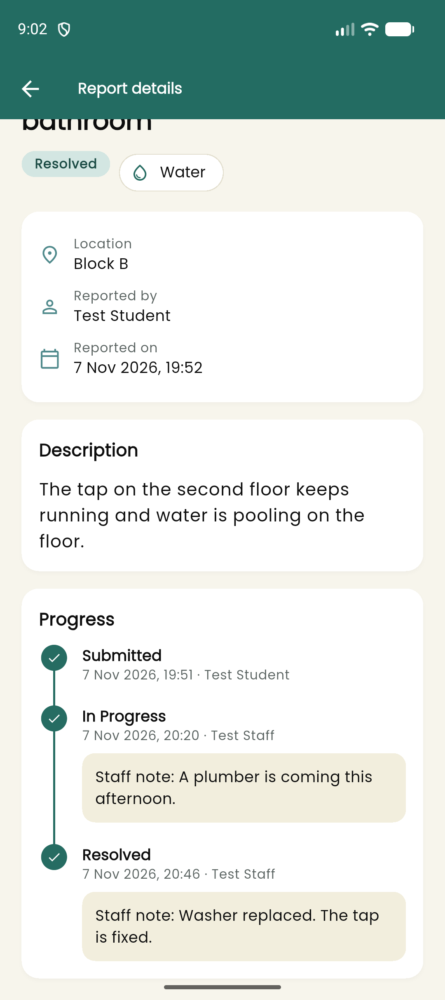
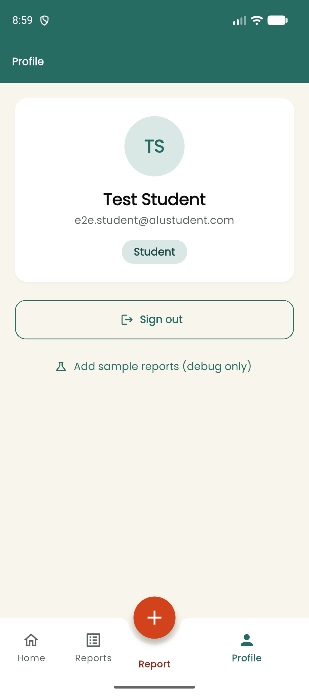
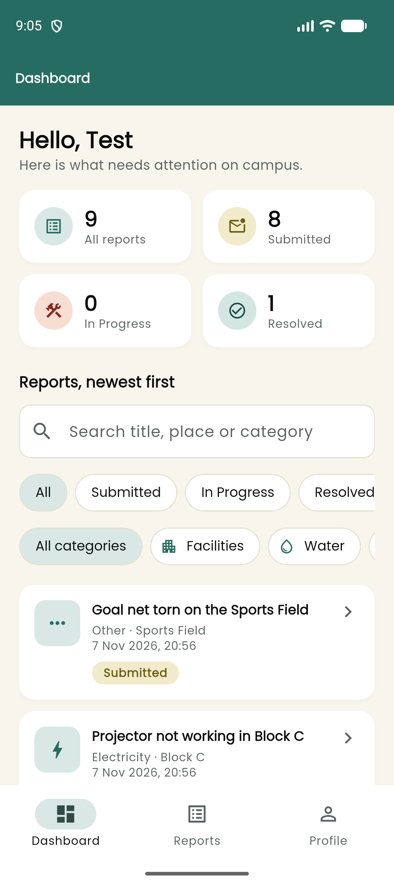
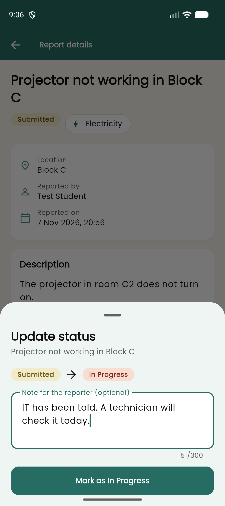

# Campus Incident Reporting App

A Flutter app for the ALU campus. Students report problems they see on campus (a leaking tap, a broken light, an unsafe path), and staff follow each report from **Submitted** to **In Progress** to **Resolved**.

Built with Flutter, Firebase Authentication, Cloud Firestore, Cloudinary (photos) and Cubit for state management. It runs on Android.

## Features

**Students**
- Sign up and log in with an ALU email (`@alustudent.com` or `@alueducation.com`). The email must be verified before the app opens.
- Report an issue with a category, title, description, location and an optional photo. The form is validated before it is sent.
- Browse all reports or only your own (**All | Mine**), search them, and filter by status and category.
- See the details of a report, including a status timeline with staff notes.
- Edit or delete your own report while it is still **Submitted**.
- Home screen with a summary of your reports and your most recent ones.

**Staff**
- Dashboard with counts by status and every report, newest first, with the same search and filters.
- Move a report to its next status and add an optional note for the reporter.

**Security**
- Roles are stored in Firestore (`users/{uid}.role`) and enforced by Firestore security rules, not only hidden in the UI.

## Screenshots

| Login | Student home | Report form |
|---|---|---|
|  |  |  |

| Reports | Search | Details |
|---|---|---|
|  |  |  |

| Status timeline | Profile | Staff dashboard |
|---|---|---|
|  |  |  |

| Update status (staff) |
|---|
|  |

## Architecture

```
Screen  ->  Cubit  ->  Repository  ->  Firebase / Cloudinary
```

- **Screens and widgets** only show state and call Cubit methods. They never import Firebase or call Cloudinary.
- **Cubits** (`flutter_bloc`) hold the state and the logic. Each state class uses `equatable`.
- **Repositories** are the only classes that talk to Firebase or Cloudinary.

| Cubit | Job |
|---|---|
| `AuthCubit` | Login state, sign up, login, logout, email verification. Listens to `users/{uid}` so a role change shows up straight away. |
| `IncidentsCubit` | Streams all reports and keeps the search text, filters and the All/Mine switch. Created only after login, so the stream stops at sign-out. |
| `ReportFormCubit` | Checks the photo size, uploads the photo, then saves a new or edited report. |
| `StatusUpdateCubit` | Lets staff move a report to the next status with a note. |

Navigation uses plain `Navigator` and one `AuthGate` widget that shows the login, verify email, student or staff screens based on `AuthState`.

### Folder structure

```
lib/
  main.dart              Firebase init and providers
  app.dart               MaterialApp, theme and AuthGate
  core/                  constants, theme (colors), validators, filter and date helpers
  models/                AppUser, Incident, StatusChange, category and status enums
  repositories/          AuthRepository, IncidentRepository, ImageUploadService
  cubits/                auth, incidents, report_form, status_update
  screens/               auth, student, staff and shared screens
  widgets/               reusable widgets (buttons, fields, cards, chips, timeline...)
test/                    unit, cubit, repository and widget tests
firestore.rules          strict security rules (deployed)
firestore.dev.rules      same rules without the ALU email check, for testing only
docs/decisions.md        log of technical decisions and problems
```

### Firestore data

```
users/{uid}
  name, email, role ("student" | "staff"), createdAt

incidents/{incidentId}
  title, description, category, location
  status ("submitted" | "inProgress" | "resolved")
  reporterId, reporterName, photoUrl (Cloudinary URL or null)
  createdAt, updatedAt
  statusHistory: [{ status, changedBy, changedByName, note?, at }]
```

## Setup

### Requirements

- Flutter 3.47 (Dart 3.13) and Android Studio with an Android emulator
- A Firebase project on the free Spark plan
- A Cloudinary account (free)
- Node.js and the Firebase CLI (`npm install -g firebase-tools`) to deploy the rules

### 1. Get the code and packages

```bash
git clone https://github.com/mufaro-k07/campus_incident_reporting_app.git
cd campus_incident_reporting_app
flutter pub get
```

### 2. Firebase

This repo is already connected to its Firebase project (`lib/firebase_options.dart`). To use your own project instead:

1. Create a project in the [Firebase Console](https://console.firebase.google.com).
2. **Build > Authentication > Get started**, then enable **Email/Password**.
3. **Build > Firestore Database > Create database**. Pick a location and start in production mode.
4. Run `flutterfire configure` and choose your project and the Android platform.

Firebase Storage is **not** used, because it needs the paid Blaze plan.

### 3. Cloudinary

1. In Cloudinary go to **Settings > Upload > Upload presets > Add upload preset**.
2. Set **Signing mode** to **Unsigned**, allow images only, and set the folder to `incident_photos`.
3. Put your cloud name and preset name in `lib/core/constants.dart` (`cloudinaryCloudName` and `cloudinaryUploadPreset`).

An unsigned preset needs no API key or secret, so no secret is stored in the app.

### 4. Deploy the security rules

```bash
firebase login
firebase deploy --only firestore:rules
```

This deploys the strict `firestore.rules`. You can also open **Firestore Database > Rules** in the Console, paste the file, and click **Publish**.

### 5. Run

Start an Android emulator, then:

```bash
flutter run
```

## Creating a staff account

Everyone signs up as a student. To make someone staff:

1. Sign up in the app and verify the email.
2. In the Firebase Console open **Firestore Database > Data > users**.
3. Open the document whose ID is that user's UID (the same UID is shown in **Authentication > Users**).
4. Change the `role` field from `student` to `staff` and save.

The app switches to the staff dashboard straight away, without logging in again. Change it back to `student` to return to the student screens.

## Testing with a personal email

For development only:

1. Set `devAllowAnyEmail = true` in `lib/core/constants.dart`. It only works in debug builds.
2. Deploy the dev rules: `firebase deploy --only firestore:rules --config firebase.dev.json`.

Before the demo, set `devAllowAnyEmail` back to `false`, deploy the strict rules again with `firebase deploy --only firestore:rules`, and check that a non-ALU email is rejected.

**Current state:** `devAllowAnyEmail` is `false` and the strict `firestore.rules` are deployed.

## Tests

```bash
flutter analyze
flutter test
```

| Test file | What it checks |
|---|---|
| `validators_test.dart` | Email domain, password, name, title and description validation |
| `incident_model_test.dart` | `Incident` and `StatusChange` `toMap` / `fromMap`, fallbacks, status order |
| `incident_filter_test.dart` | Search and status/category/Mine filters |
| `incident_repository_test.dart` | Create, status update with history, edit and delete (uses `fake_cloud_firestore`) |
| `image_upload_service_test.dart` | Cloudinary upload returns `secure_url` and fails on errors |
| `auth_cubit_test.dart` | Unauthenticated, unverified, live role change, login error message |
| `incidents_cubit_test.dart` | Loading, error state, filters and Mine |
| `status_update_cubit_test.dart` | Status update with a trimmed note, and the error case |
| `report_form_test.dart` (widget) | Form shows every validation error, and a valid report is submitted |

### Checking the security rules

With one student account and one staff account:

1. As the student, try to change the status of a report (for example in the **Rules Playground**: `update` on `incidents/{id}` with `status` changed). It must be **denied**.
2. As the staff account, update the status from the app. It must **work**.
3. As the student, try to set your own `role` to `staff`. It must be **denied**.
4. Sign in with a verified non-ALU account. Reading `incidents` must be **denied**.

## Known limitations

- Photos are uploaded with an unsigned Cloudinary preset, which cannot delete files. Deleting a report leaves its photo in Cloudinary.
- Search runs on the reports already loaded on the phone, because Firestore has no full-text search. This is fine for one campus but would need a search service for a large dataset.
- Times inside the status history come from the phone's clock, because Firestore does not allow `serverTimestamp()` inside arrays.
- The campus locations in `lib/core/constants.dart` are placeholders.
